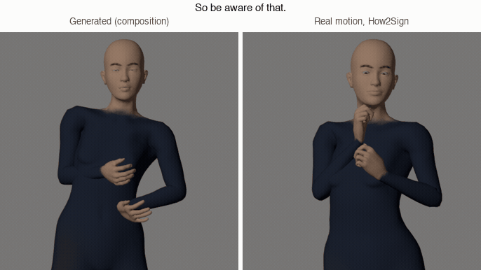
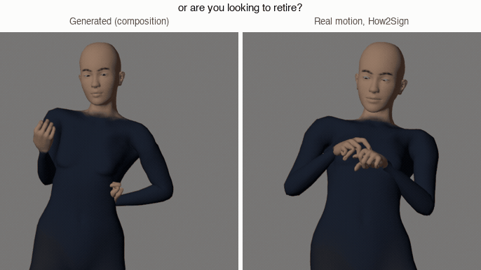
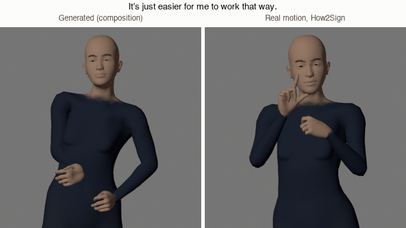
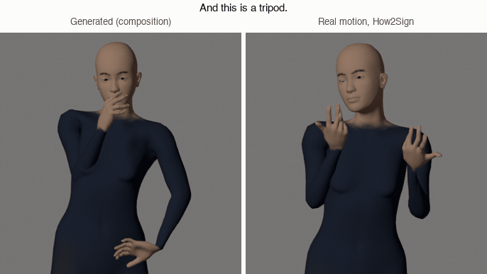
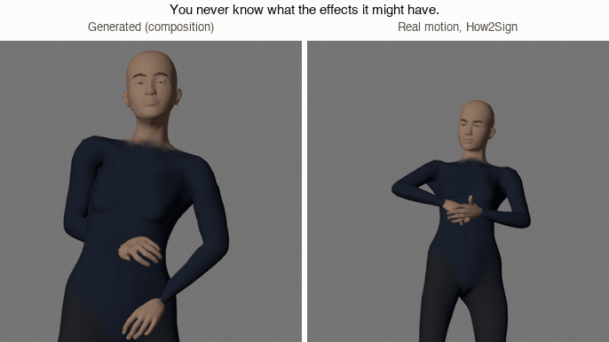
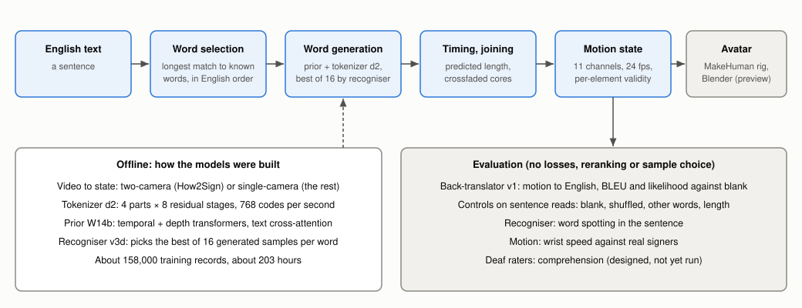
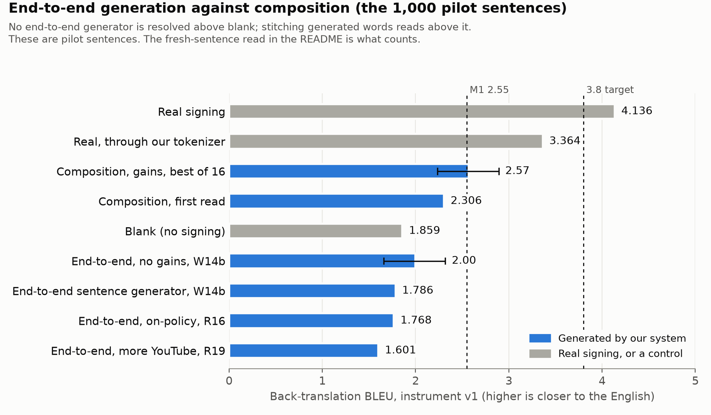
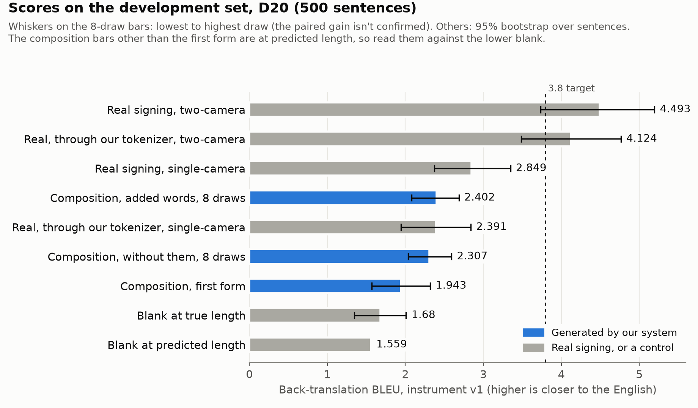

# Sign-Translator

Research toward turning English text into American Sign Language (ASL) motion on a 3D avatar.

> **Status on 2026-11-01: research in progress, not a working translator.** No Deaf reader has judged the output yet. The first milestone (M1) was **not met** on fresh sentences. Licensing and legal terms will be revised properly once the model is finished; see [section 13](#13-legal-status).

This README is a procedural account of the project: what was built, how it was tested, what worked, what failed, and what we got wrong. Measured numbers come from recorded runs; odds and arithmetic are marked as such. The day-by-day record, with rules written before the read and what was already known stated beside them, is [`docs/NEXT_PHASE_PLAN.md`](docs/NEXT_PHASE_PLAN.md) (6,200+ lines).

**Contents:**
[1. Summary](#1-summary) ·
[2. Demonstration](#2-demonstration) ·
[3. The pipeline](#3-the-pipeline) ·
[4. Methods](#4-methods) ·
[5. Data](#5-data) ·
[6. How we measure](#6-how-we-measure) ·
[7. Results](#7-results) ·
[8. Timeline](#8-timeline) ·
[9. Achievements](#9-achievements) ·
[10. Hardships](#10-hardships) ·
[11. What we got wrong](#11-what-we-got-wrong) ·
[12. Open questions and next steps](#12-open-questions-and-next-steps) ·
[13. Legal status](#13-legal-status) ·
[14. Scale and repository](#14-scale-and-repository)

---

## 1. Summary

**The aim.** Given an English sentence, produce signing motion a Deaf reader understands. We score output with a *back-translator*: a model trained to read real signing motion and write the English. If it can recover the sentence from our motion, some meaning got through. This is an imperfect stand-in for Deaf readers, who will have the final word: our best outputs still back-translate to mostly invented English, and blank motion itself scores about 2.

**The main finding so far.** Generating a whole signed sentence end to end did not work: the best read doesn't separate from no signing at all, and most generators read below it. Generating each word separately and stitching the words together does score above that baseline, so stitching (*composition*) is now the path.

**Where we stand**, in BLEU (0 to 100, higher is better; real signing reads only about 4 on this instrument):

| Read | Form | Score | Real signing | Blank | Share of the blank-to-real gap |
|---|---|---|---|---|---|
| **Fresh sentences, one read, C20** | Gains, best of 16, true length | **2.400** [2.06, 2.737] | 4.033 | 2.053 | 17.5% |
| Pilot sentences, the 1,000 | Gains, best of 16, true length | 2.570 [2.236, 2.892] | 4.136 | 1.859 | 31.2% |
| Development set, D20, mean of eight word draws | No gains, added words, predicted length | 2.402 (draws 2.08 to 2.687) | 4.493 | 1.559 at predicted length (1.68 at true length) | 32.5% |
| Best end-to-end generator, the 1,000 | W14b, no gains | 2.000 [1.66, 2.319] | 4.136 | 1.859 | 6.2%, not resolved above blank |

Each read uses the blank at its own length. True-length forms need the answer's length, so they can't be deployed. C20's form at predicted length read 1.985 [1.615, 2.359] on D20. "Gains" are fixed decoder multipliers (body 1.17, hands 1.28, 1.27).

| Target | Value | State |
|---|---|---|
| M1 | 2.55 | **Not met** (fresh read 2.400, no retry) |
| Long-term instrument target | 3.8 | Not reached by any form |
| Release bar with Deaf raters | Comprehension lower bound at least 70%, within 10 points of real | Not started |

**The newest result, which may change the plan.** Most of our word clips were learned from single-camera data, while the real signing we compare against was recovered from two cameras. Read through the single-camera path, that same real signing scores **2.85, not 4.49**. Composition's 2.40, the mean of eight draws of a form chosen on D20, is already close to that (the declared comparison without tracking marks is 2.65 against 4.62). But the instrument our main one was built from, before its tuning on two-camera motion, reads the two paths about equally (99.8%, against 18% for the main instrument). So the drop may come largely from that tuning rather than lost detail, though this isn't proven ([section 7.3](#73-the-single-camera-result)).

---

## 2. Demonstration

Left: our best-scoring composition form so far (added words, predicted timing, report only, not adopted). Right: the real signer's motion for the same sentence, recovered from two cameras and shown on the same avatar. **Nobody fluent in ASL has judged either side on this rig, and we don't claim the generated clip is correct signing.**

**How these were picked:** a fixed random rule over D20 (`random.Random(2026)`, sentences of 5 to 9 words), run before any render and never by score, so the clips aren't cherry-picked. All six sentences are shown, including the one that failed.

| Sentence | Words with a generated clip |
|---|---|
| So be aware of that. | so, that |
| or are you looking to retire? | or, you, look, retire |
| It's just easier for me to work that way. | it, for, work, that |
| And this is a tripod. | and, this |
| You never know what the effects it might have. | you, never, know, what, it |
| Jasmine rice is a Thai rice. | none |











**What these show, good and bad:**

- **Missing words:** the system has clips only for words it knows, so sentences lose words. "tripod" isn't in its vocabulary, and "Jasmine rice is a Thai rice" has no known word, so the system signs nothing at all for it.
- **No ASL grammar:** words follow English order, because structure read lower when tried, on an instrument that prefers English order. That doesn't show ASL grammar is wrong for this. Real ASL has its own grammar, and facial expression carries part of it.
- **Timing:** predicted length often differs from the signer's. In the last clip the real motion runs 14.7 s against our 3.3 s, and only the first 8 s are shown.
- **Arms:** generated arms can rest or move too fast between words.
- **Avatar:** a preview rig. It's bald and flat, with hands that can pass through the body, for both sides alike.


---

## 3. The pipeline



| Stage | What it does | State today |
|---|---|---|
| Text input | English sentence | Text only. Speech is left for after the generator passes |
| Word selection | Longest match to known single-word clips, inflection fallback, stop words dropped, English word order | 705 entries on D20, 712 with added words. Unmatched words fell from 34.7% to 23.3% |
| Word generation | Prior W14b samples each word 16 times through tokenizer d2. Recogniser v3d keeps the best | A recogniser finds the right word in its top 5 for 0.583 of them; no human has judged them |
| Timing and joining | A text-only model predicts length; word cores are crossfaded over 0.15 s | Runs about 1.2× long, and wrists run too fast |
| Motion state | 11 channels at 24 fps with validity marks | Stable |
| Avatar | MakeHuman rig rendered headless in Blender | Preview quality: bald, flat, with hands passing through the body and some shake |
| Evaluation | Back-translator, recogniser, motion statistics, Deaf raters | Only one accepted sentence instrument; rater tooling built, raters not started |
| Serving | `signtranslator/serving/` | No measured service level |

---

## 4. Methods

### 4.1 Motion representation

A signed clip is stored as a **canonical state** of 11 channels: root translation, body rotations (6D), left and right hand rotations, head rotation and translation, 52 face coefficients, gaze, blink and contact. Every element has validity, observed and confidence marks, so stored states record what's missing. Downstream isn't clean: tokenizer targets put neutral values on untracked frames, and generated output marks every frame as tracked.

There are two recovery paths, and the difference between them turned out to matter a great deal:

| | Two-camera (How2Sign) | Single-camera (every other corpus) |
|---|---|---|
| Landmarks | Sapiens, 308 keypoints on both views | MediaPipe, 33 pose and 21 per-hand world landmarks |
| 3D | Lag estimate, bundle adjustment with a rigid-bone term, triangulation | Direct from MediaPipe's world points |
| Rotations | Swing inverse kinematics | Swing inverse kinematics, twist declared zero |
| Share of the generator's single-word clips, records, word occurrences | 0.27%, 8.8%, 27.2% | The rest |

Without the rigid-bone term, bundle adjustment got focal lengths 40-47% wrong; with it, within 1%.

### 4.2 Tokenizer d2: motion to codes

A residual vector-quantised autoencoder (d2 is the tokenizer; D20 is an evaluation set) with 4 body parts × 8 stages = **32 codes per frame**, 512 entries per codebook, and no temporal downsampling, giving **768 codes per second**.

```text
r_0 = z,   r_q = r_(q-1) − e_q,   ẑ = Σ_q e_q        residual quantisation
ẑ_st = z + stop_gradient(ẑ − z)                      one straight-through estimator over the cascade
L = L_channels + L_position + 0.5·L_velocity + 0.25·L_acceleration + 0.3·L_head-velocity + 0.25·L_commit
```

The channel loss uses sin²(θ/2) on rotations, Huber on translations and (1−cos)/2 on gaze. Codebooks are EMA-updated, with dead-code reseeding and quantiser dropout.

Reconstruction improved from 19.1° and 10.9 cm (one VQ) to 8.3° and 1.7 cm (v2b, the full-rate residual d2 descends from; these are not d2's own figures), against a data noise floor of 2.0° and 0.9 cm. Coarser tokenizers at 6 and 12 Hz lost hand motion or diverged, and nine other candidates failed fidelity checks.

### 4.3 Prior W14b: text to codes

An autoregressive transformer over codes:

```text
p(c | text) = Π_t Π_j p(c_t^j | c_t^(<j), h_t),      h_t = Temporal(text, c_(<t))
```

A causal temporal transformer (6 layers) runs over frames, with cross-attention to a byte-level text encoder (4 layers). A small depth transformer (2 layers) predicts the 32 codes inside each frame. d_model is 384. It samples with classifier-free guidance 1.5.

**Exposure bias was the first wall.** A recogniser read real word clips at 0.917, tokenizer reconstructions at 0.883 and one-step predictions at 0.82-0.87, but free-running samples at **0.017**. A combination fixed this for isolated words: clips trimmed to the sign, one-word clips dominating the samples, history dropout 0.5, and no loss on untracked parts. That took free-run to **0.67-0.80** on 60 frequent training words (0.57-0.69 on a harder list of 108 words). It did not fix sentences: there, text moves stage-1 codes by at most 0.025 nats, about 1% of their entropy, and that held for all three text encoders tried.

### 4.4 Composition: stitching generated words

1. Match the sentence's words to known entries, longest first.
2. Generate 16 samples per word, each with fixed seeds, independent of the sentence.
3. Keep the sample recogniser v3d rates highest for that word. Entries without a label (267 of 705) use the prior's word association instead.
4. Predict the sentence's length from text alone: `seconds = −0.083 + 0.369 × tokens`.
5. Place the word cores and crossfade them over 4 frames.

Variants tested on D20 include added common words, left-arm holds, tempo changes and low-pass filtering; [section 7](#7-results) lists the main ones. A fitted-length test was built, but its declared gate needed A5 to pass, so it hasn't run.

### 4.5 Instruments

| Instrument | What it does | State |
|---|---|---|
| **Back-translator v1** | 48 forward-kinematics points projected to 2D, into a T5 decoder. Pretrained on 323,978 clips, fine-tuned on How2Sign | The only accepted sentence instrument. It carries a known bias risk toward two-camera motion |
| Back-translator v2 | Reads 3D states directly, trained on 151,481 clips | **Not accepted**: real 1.871, gap to its best control +0.019 [−0.259, +0.221]. Claims that needed its agreement can't be made until a new instrument passes |
| Recogniser v3d | Word recogniser trained with decoded-copy augmentation | Picks the best samples, so its own reads of the chosen words are circular, and it never grades them |
| Recogniser v2 | Word-spotting guard, not fully independent of v3d (shared training data) | Scores can't be compared across word sources |
| Deaf raters | Comprehension, negation, naturalness | Protocol and tooling built, tested on synthetic data; raters not recruited |

### 4.6 Tried and rejected

| Approach | The number that decided it |
|---|---|
| Regression decoder | Hand speed 0.002× real |
| Motion diffusion | Samples at 0.15-0.18× real speed |
| Plan-conditioned generator | Sign accuracy 0.5% against real 97.3% |
| Gloss planner, gloss-order words | Gloss-order words on grammar corpus 0.675, English order 0.932, on a read that can't separate real from blank there (0.708, 0.637) |
| Coarse tokenizers | 6 Hz hands at 0.45× speed; 12 Hz diverged twice |
| Plan tokenizers (three) | Round trip 0.795×, 0.749×, 0.777× of d2, against a 0.8× bar |
| Pretrained text encoders | Lexicon 0.0133 and 0.0033 against control 0.0167 |
| Guided attention | BLEU −0.186 [−0.533, +0.172] |
| Sentence refiners | −0.55 [−0.89, −0.21] |
| On-policy rollout, R16 | −0.018 [−0.333, +0.295] against W14b |
| More YouTube data, R19 | 1.601 and 1.543, below W14b's 1.786 |
| 2D-to-3D arm lifter, two versions | Failed its gates: forearm 1.69×; then wrists 18.62° against a 15° bar |
| Masked decoding | Closed before training: its gauge read 8.25 on a truth of 4.13 |

---

## 5. Data

About 158,000 training records and 203 hours in the generator's mix. Video stays in private storage and is not redistributed here.

| Corpus | Size | Used for |
|---|---|---|
| How2Sign | 67 h, about 35,000 clips per view; 18,289 training records | Generator, tokenizer, instrument, sentence evaluation |
| YouTube-ASL | 372 h collected of 984 h listed; 99,918 training records | Generator, tokenizer |
| YouTube-ASL keypoints (UWB) | 390,547 clips, 2D only | Instrument pretraining |
| ASLLRP DAI 2 | 2,127 utterances | Generator, grammar and timing studies |
| ASLLVD, RIT, WLASL | 5,155; 5,295; 1,045 training records | Generator, recogniser |
| One further lexical corpus | Not stated here pending approval under its terms | Generator, recogniser |
| ASL Citizen | 83,399 videos, 52 signers | **Recognition only** |
| ASL STEM Wiki | 64,266 videos | **Instruments only** |
| 2M-Flores-ASL | 2,015 sentences | Held-out instrument domain |

**Evaluation sets** come from How2Sign validation signers, and each has a job:

| Set | Size | Job | Rule |
|---|---|---|---|
| D20 | 500 | Compare methods | Reused, so scores flatter |
| The 1,000 | 1,000 | Pilot | Read many times, so it flatters; in round 20 it also chose which arm read C20. "The 1,000" names this set only; C20 is a separate 1,000 |
| C20 | 1,000 | Fresh claim | **Read once**, one arm, no retry |
| Reserve | At most 562 | One final fresh claim | Unread |
| How2Sign test signer | | Final check | See [section 11](#11-what-we-got-wrong) |

**A limit on these sets:** they're fresh to the generator's decisions, but not to instrument v1, whose fine-tuning lists include 234 of D20's clips and 455 of C20's. Real signing doesn't read higher on those clips, on either set, so we see no sign of simple clip memory, and C20's result is about the same on both sides (2.46 and 2.35). Signer differences are large, though: D20's real score runs from 2.77 to 5.56 by signer.

---

## 6. How we measure

- **BLEU:** back-translation against the English. Low in absolute terms even for real signing.
- **Controls on sentence reads of generated motion:** blank motion, shuffled word order, other sentences' words, and clip length. A score means little without them.
- **Gap share:** `(score − blank) / (real − blank)`.
- **Likelihood above blank:** how much more likely the motion makes the true English than blank does. It has less than half of BLEU's noise (half-width 0.084 against 0.188).
- **Word spotting:** the recogniser slides over the sentence and looks for the words.
- **Loop share:** how much the output repeats itself. Translators loop on poor input (54.4% on stitched real word clips and 54.0% on our best form, against 28.2% on real signing), and that can inflate BLEU.
- **Wrist speed:** chest-frame wrist speed, compared with real signers.

**Release bar, set before any rater read.** Comprehension Wilson 95% lower bound at least 70%; within 10 points of real signing on the same sentences; negation recovered; wrist speed inside the real-signer range; all at predicted timing, on unseen signers.

**How the work is kept honest:**

- **Rules first:** each test's rule goes in the plan with a UTC time and commit before its read, stating what was already known. Amendments are numbered and disclosed.
- **Rules that hold:** a form that missed by −0.022 was not adopted, nor one that missed by 0.0007.
- **Frozen code:** since Nov 1 (after C20), a digest of the code and environment is recorded with each read, a mismatch is refused, and outputs are write-once.
- **Canary:** reads since Nov 1 first reproduce stored scores. The latest matched 4.493 and 1.68 exactly.
- **Independent review:** a review pass separate from the build covers nearly every change before it runs, and unreviewed items are marked as such. Reviews often send work back ([section 11](#11-what-we-got-wrong)).
- **Mutation testing:** deliberately broken code must be caught by tests. Reviewers' own mutants still survived 25 of 31 and 17 of 33 on Nov 1, so a builder's own mutants don't prove a test suite strong.
- **No training without evidence:** since Oct 30 18:50 UTC, no generator or tokenizer training has started unless research plus simulation showed a better chance. Back-translator v2 did train after that, and was not accepted.
- **Instruments stay separate:** back-translators never feed losses, reranking or best-of-16. Their D20 reads do choose among forms, which is one reason D20 flatters.

---

## 7. Results

### 7.1 End-to-end against composition



No end-to-end generator was resolved above blank on sentences. Point estimates reach 2.000 [1.66, 2.319] on the 1,000 and 2.18 against 2.14 for F12, and on D20 likelihood stays below blank at both lengths. Word-level generation works, so stitching became the path. First composition above blank: +0.45 [+0.06, +0.86], the 1,000.

About half of the 2.306 to 2.570 gain came from fewer loops rather than more content, by our audit (content alone about 2.45).

### 7.2 Development set D20



| Test on D20 | BLEU | Likelihood above blank | Wrist vs real | Outcome |
|---|---|---|---|---|
| First composition form | 1.943 [1.57, 2.32] | | 2.60× | Baseline |
| Best of 16 samples | 2.328, +0.385 [+0.014, +0.791] | | 2.57× | **Adopted** |
| At predicted timing, no gains | 2.183 | +0.0764 | 1.53× | Comparator |
| Left-arm hold | 2.265 | +0.0487 | 1.29× | **Failed**, loses likelihood and spotting |
| Added common words, first draw | 2.526 [2.111, 2.925] | +0.0891 | 1.77× | Passed its rule, one draw, report only |
| **Added common words, eight fresh draws** | **Mean 2.402, against 2.307 without.** Paired +0.095 [−0.078, +0.269] | Paired −0.0022 [−0.0227, +0.0182] | 1.81× | **Not confirmed. Not adopted** |
| Same, at the true length | 2.855 [2.371, 3.283] | | | Not deployable: needs the answer's length |

**Added words did not hold up.** Eight fresh draws, read once under a rule declared in advance, did not confirm the first draw's +0.343 [−0.018, +0.718] on BLEU and +0.0128 [+0.0015, +0.0235] on likelihood: the first draw was a high one. BLEU rose in 6 of 8 draws and likelihood in 5 of 8. Word spotting did rise in all 8, +0.0131 [+0.0073, +0.0188], so the added words are detectably there, but a sentence-level gain isn't shown. This isn't evidence against the form either: the test had limited power, with a paired draw SD of 0.2075. On the first draw, wrist speed rose, loop share was 54.0%, and echo of the new words did not rise, so part of the gain may be speed rather than coverage. D20 chose this arm, the read ran under a disclosed GPU exemption after its number had been seen, and pointing and fingerspelled entries need Deaf review. Stitched real word clips read no higher (2.17 against 2.306 on the 1,000; 2.176 against 2.526 for added words on D20), which better words alone won't fix and which may say something about the instrument.

**Word draws matter.** Five real-clip draws moved D20 between 1.821 and 2.414 (SD 0.237). Our intervals leave that out, so every single-draw result, including the fresh read, looks surer than it is. The eight-draw test above is called A5 in the plan (section "A5, eight word draws, declared"; earlier A5s in the plan are other tests). Its result is what a single draw can't show. Even a pass would not have been a fresh-sentence result.

**Tokenizer.** We suspected the tokenizer capped scores, and on two-camera input that doesn't hold as stated. Without neutral fill on untracked frames, a real-signing round trip reads 4.124 [3.485, 4.764], or 86.9% of the BLEU gap and 64.5% of the likelihood gap, on one D20 read. We kept d2 and skipped a retrain. The single-camera round trip reads 2.391, with its upper bound below 3.8. A control also showed real's tracking marks carry some sentence content no generator can emit, about 7% of its likelihood gap, so shares against 4.493 are somewhat understated.

### 7.3 The single-camera result

Same 500 clips, instrument v1, all safety checks clean, control exact:

| Real signing | BLEU | Likelihood above blank |
|---|---|---|
| Two-camera | 4.493 [3.733, 5.195] | +0.292 |
| Single-camera | 2.849 [2.373, 3.348] | +0.056 |
| Two-camera, nearest fill, no tracking marks | 4.621 [3.837, 5.369] | +0.234 |
| Single-camera, nearest fill, no tracking marks | 2.653 [2.165, 3.077] | +0.041 |
| Through the tokenizer, two-camera | 4.124 [3.485, 4.764] | +0.188 |
| Through the tokenizer, single-camera | 2.391 [1.947, 2.838] | +0.024 |
| Single-camera values, two-camera marks | 2.546 [2.072, 2.999] | +0.097 |
| Two-camera values, single-camera marks | 4.497 [3.727, 5.242] | +0.235 |

- **The drop is in the motion values:** swapping tracking marks barely moves either path, and trimming clips to the same frames changes nothing.
- **Hands differ most:** distance between paths is 0.587 for hands (a deliberately mirrored control reads 1.286), 0.231 for wrists, 0.128 for elbows and 0.100 for shoulders.
- **Which part:** swapping one part at a time into real two-camera motion shows both body and fingers lose v1's reading, with heavy overlap. Share of the likelihood loss: hand pose 80%, body with wrist orientation 77%, hand orientation 55%, arms 34%. This names where v1's reading falls, not which part lost content.
- **The instrument:** v1's parent, before fine-tuning on two-camera motion, reads the paths equally on how much the motion favours its own sentence over others, measured above a still pose: 99.8% [92.6, 107.6] of the two-camera margin, against v1's 17.6% [5.2, 28.2] over blank. Its own training score reproduced exactly (6.0888). This points at v1's fine-tune.
- **What it can't tell us:** the parent learned from MediaPipe image landmarks, the source of the single-camera hands, so it could be generous to that path, and its BLEU leaves part of a gap unresolved (1.95 against 2.21). We haven't shown it can see fingers at all, which is the next test.
- **Why it matters:** if it's real, composition may have little room left on this instrument. By arithmetic on the eight-draw mean, its 32.5% share is about 100% (roughly 70-165%) of the single-camera gap. That is an inference, not a measurement. Composition's clips aren't simply single-camera, since d2's decoder and How2Sign's weighting differ, and its likelihood +0.089 sits above real single-camera's +0.056.

### 7.4 Motion quality

Composed wrists run too fast. Length fitting squeezes word cores 1.96×, and joining adds movement. Against D20's signers, the added-words form is 1.77× real on its first draw (left 2.23×, right 1.46×), 1.81× over eight draws, and through the same single-camera path both arms read about 1.9×.

We then compared against 75 groups: 9 named signers and 66 YouTube channels (120 of 355 qualifying channels read). The form sits inside their 10th-90th percentile range on 5 of 6 readings, at the 85th-89th percentile and faster than 7-8 of the 9 named signers. This rerun is unreviewed and no rule reads it, and D20's own signers mostly fail that range, so it is not a pass. **Timing and speed also pull against each other:** truer timing scores higher but moves wrists further out of range.

---

## 8. Timeline

Dates are 2026, UTC. Numbers are BLEU unless stated. "Lexicon" is the share of generated words whose right word lands in a recogniser's top 5; blank reads 0. The recogniser changed over time, so W14b's 0.583 (v3) and its 0.390 (earlier) are not comparable, nor is 0.583 with F12's 0.4267.

| Date | Step | Deciding number | Outcome |
|---|---|---|---|
| Jul 16 on | Synthetic baseline, governance, evidence modules | Synthetic only | Foundations |
| Oct 18-19 | First real data; regression, diffusion, tokens | Hand speed 0.002×, 0.15×, 0.17× real | Tokens chosen |
| Oct 21 | First generator on a 12 h subset | Fréchet 214 on validation, 255 on test | Baseline |
| Oct 23 | Full corpus; strict review | Words recognised 0% against real 99.4% | **Failed** |
| Oct 23-26 | Rounds 3 to 3e, multi-signer | Gate 95 of 95, but sentences 1.60 against blank 2.14 | **Failed**; passing the gate was not enough |
| Oct 25 | Tokenizer candidates | 9 of 9 rejected, then d2 adopted | Tokenizer settled |
| Oct 26-27 | Rounds 4-9: text encoders, corruption, scheduled sampling | Free run 0.017-0.133 | Not promising |
| Oct 27 | **Round 11:** isolated words first | **Free run 0.67-0.80**; lexicon 0.45-0.53 | Words learnable |
| Oct 28 | **Round 12:** F12 | **Lexicon 0.4267**; 1.806 | First promising arm |
| Oct 28 | F12 full review | 2.18 vs blank 2.14; gate 79 of 95 | **Failed**; test set left unread |
| Oct 28-29 | Rounds 14-15: more words, composition | Real-word oracle 2.58; W14b words 2.195 | Read then as words being the bottleneck; on the 1,000 real words read 2.17, no higher than generated 2.306 |
| Oct 29 | **Composition on the 1,000** | **2.306**, +0.45 [+0.06, +0.86] vs blank | First above blank |
| Oct 29 | M1 set at 2.55 | | Milestone |
| Oct 30 | Rounds 16-19, lifter | 1.768, gates failed, 1.601 | All **failed** |
| Oct 30 | Evidence-before-training rule | | In force |
| Oct 31 | Round 20 on D20 | Best of 16: 2.328 | Adopted |
| Oct 31 | Pilot read on the 1,000 | 2.570 [2.236, 2.892] | Rule failed; crossing 2.55 not established |
| Oct 31 | **Fresh read, C20** | **2.400** [2.06, 2.737] | **M1 not met** |
| Nov 1 | Left-arm hold | Likelihood −0.0276 | **Failed** |
| Nov 1 | Added common words | 2.526 | Passed, one draw |
| Nov 1 | Tracking-mark and tokenizer probes | Round trip 4.124 | No retrain; "3.8 unreachable" withdrawn |
| Nov 1 | Masked decoding, the last end-to-end route | Gauge read 8.25 on truth 4.13 | Closed untrained, "not shown"; reopens only on a declared direct read |
| Nov 1 | Back-translator v2 | Real 1.871, gap +0.019 | **Not accepted** |
| Nov 1 | **Single-camera read** | **2.849 vs 4.493** | Possible root cause, unresolved |
| Nov 2 | Parts and parent read | Both body and fingers on v1; parent reads the paths equally, 99.8% | Points at v1's tuning, not proven |
| Nov 1 | **A5, added words over eight draws** | **+0.095 [−0.078, +0.269]; likelihood −0.0022** | **Not confirmed**, not adopted; follow-up A6 not run |

---

## 9. Achievements

- **A full pipeline from raw video to avatar:** multi-corpus extraction, two-camera triangulation, tokenizer, prior, composition, evaluation and render.
- **A failure fixed at word level:** free-running word generation went from 0.017 to 0.67-0.80 on 60 frequent training words (0.57-0.69 on a harder list of 108 words).
- **Generated motion read above controls on fresh sentences, narrowly:** +0.347 [+0.011, +0.692] over blank on C20, on one instrument and one word draw, with no human reader.
- **A tokenizer that, on two-camera input without neutral fill, kept 86.9% of the BLEU gap and 64.5% of the likelihood gap, on one D20 read.**
- **Controls and declared rules that caught our own mistakes:** several tempting results were dropped by them. The measurement itself rests on one imperfect instrument.
- **A rater study designed and built:** protocol, two-stage sheets, blinding, scoring and simulations, tested on synthetic data only. It still needs a re-check, a real data export, hosting, a Deaf checker and raters.
- **An unresolved single-camera finding:** real signing reads far lower through that path. It may mean lost detail or an instrument fitted to two-camera motion, and these lead to different work.

---

## 10. Hardships

| Problem | What happened | What we changed |
|---|---|---|
| Passing gates that meant nothing | A generator passed 95 of 95 motion checks and still couldn't convey sentences | Sentence-level reads with controls decide |
| Instruments that misled | An early text reader rated generated motion above real (0.78 vs 0.60). v1, our only accepted instrument, gave a speed-up +0.615 without added content, and read real signing no better than blank on a grammar corpus | Same-form checks, relative reads, controls on every read |
| Impossible test | A per-token bar was 25-35× above its theoretical limit | Compute a bound before setting a bar |
| Machine crash | Laptop panicked under 8 threaded workers on Oct 21, wiping temporary files, watchers and an SSH key | 1 BLAS thread, about 6 processes, a memory guard, ops files off temp storage |
| Sync corruption | iCloud created duplicate files in a commit; after reboot, 296 of 343 code files were placeholders that Python read as empty and exited 0 | Off-iCloud clone and environment |
| YouTube bot checks | Downloads blocked at 372 of 984 hours, then at the first video each day | We stop for the day: no cookies, sign-in, proxies or bypass |
| Overwritten data | A duplicate extractor rewrote 1,426 states; 233 records mismatched and a silent skip hid it until a crash | Every state hash checked before training; 100,454 verified |
| Arms out of frame | About 42% of YouTube clips have no usable wrist, because hips and elbows are out of shot | Loss mostly ignores them, though their neutral body codes stay as history for hand codes; recovery needs 850 re-downloads and the lifter failed. Effect unmeasured |
| False success | A pipe hid a missing tool, so "JOB-DONE 0" meant tests never ran | `pipefail`, read real exit codes |
| Tests hitting real storage | The suite on a pod with live credentials launched real jobs; an audit of 1.47 million objects found no test-written object in the prefixes scanned | Tests strip credentials |
| Early stop too soon | A noisy monitor stopped an instrument's training at 14,000 of 60,000 steps | Patience raised, disclosed. It later failed on the merits |
| Pod operations | Idle pods with healthy-looking logs; a self-killing `pkill` left two trainers on one GPU; 6 pods launched against a limit of 5 | Judge by measured use; kill by PID; lock and reservation for slots |
| Word-draw noise | The same method moved 0.59 between random draws | Multi-draw runs; lead with likelihood |
| No external readers yet | Raters depend on recruitment, pay, ethics review and a Deaf checker | Tooling is built; it is not yet run on real data |

---

## 11. What we got wrong

We keep these visible on purpose, because being wrong was a regular part of the work.

| Claim | What happened |
|---|---|
| A skeleton-slot handedness measure said some signers were mirrored, so we flipped them | Wrong. Scores fell, three independent measures disagreed, and it was withdrawn. "Likelihood preference is not handedness" |
| Exposure bias is the cause | Partly. It was the word-level cause, and it does not explain sentences. The plan records the change of view |
| The tokenizer makes 3.8 unreachable | Withdrawn as stated: mostly neutral fill, on one D20 read. The cap on the 1,000 is not re-measured, and the single-camera round trip stays below 3.8 |
| Real hands fold onto the wrist | Withdrawn: 0 of 61,324 on recheck |
| Composition is inside all six wrist readings | Wrong. 26 channels were silently empty, the first table was mislabelled, and a review stopped it. Rerun: 5 of 6 |
| A safety check found a mismatched clip | Bug in the check, which compared resampled clocks. Stored clocks matched on all 46 clips sampled |
| "Test set untouched" | Only since Oct 28. Early rounds did read How2Sign's test signer, in the generator round, Task 1 and rounds 3, 3b and 3e. A guard now refuses it unless every validation rule passes. Two metadata prints were later disclosed |
| Round 13's data clean-up "stands" | The plan said so, but the current generator's mix still holds those clips. The record and the mix disagree |
| Declared times | Written from memory, they drifted 20-80 minutes ahead. The clock is now read first |

Some changes loosened a rule after we saw numbers. Each is disclosed in the plan: the gate that kept C20 shut unless the pilot's rule passed, the rater statistics method, a patience setting, a GPU-name exemption, a motion bar on the left-arm test, and the wrist range.

---

## 12. Open questions and next steps

**Open questions:**

1. Does single-camera recovery lose real detail, or is the instrument biased? (Next: a finger-sensitivity test, composition read through the parent, and an instrument tuned on single-camera motion instead. These instruments share a lineage, so a clear answer may need human readers.)
3. Do arm-less YouTube clips hurt the generator? (Unmeasured. The one direct test showed no gain, but it was short.)
4. Would Deaf readers understand any of this? (Unknown, and the most important question.)
5. Which wrist range is right, given that real signers fail the current one?

**What each answer leads to:**

| If | Then |
|---|---|
| Single-camera detail is really lost, and instruments prove sensitive to fingers | Better hand recovery on word clips comes before more composition tuning. Source videos are still held for the main word corpora |
| The instrument is biased | Build a fairer instrument. Scores so far may understate composition, and the 3.8 target needs rethinking, since it was set on v1 |
| Any of these reaches a credible level | First Deaf rater read, at least nine raters. That read is diagnostic: it fails the wrist and timing conditions by construction |

**Our own odds, as judgement rather than measurement, all before the single-camera read:** on Oct 31, under 5% each for deployable or 3.8 by Nov 15; on Nov 1, a later estimate of 5-10% for 3.8 within three months and under 5% for the release bar.

---

## 13. Legal status

**This section is a placeholder until the model is finished.** At that point we will add full citations, each dataset's terms and a final licence review.

- **Code:** Apache-2.0 ([`LICENSE`](LICENSE)).
- **Model weights:** not released.
- **Datasets:** held privately, and not redistributed. Several are research-only or carry specific conditions. Some terms limit how a dataset may be used or discussed, so this README reports no results specific to those corpora. The plan and reports in this repository do discuss them; that is under review.
- **Clips in this README:** rendered 3D avatar motion for demonstration only, with no video of any real person. The "real" motion and the English sentences come from How2Sign (Duarte et al., CVPR 2021, https://how2sign.github.io/, CC BY-NC 4.0); we recovered and re-rendered the motion. The GIFs in `docs/figures/demo/` are CC BY-NC 4.0, not Apache-2.0.
- **Known open items:** consent scope for a recogniser trained on recognition-only data but used to pick words; dataset attribution wording; the terms of each source.

---

## 14. Scale and repository

| Item | Value |
|---|---|
| Duration | July 16, 2026 to now; real-data work since mid-October |
| Commits | About 960 |
| Python | 1,021 files, about 210,000 lines (package 70,267, tests 77,360, scripts 56,683) |
| Tests | About 5,800 test cases |
| Compute | $1,224 over 360 cloud GPU and CPU pods since Oct 20, not counting storage |
| Plan | 6,200+ lines, chronological |

```text
signtranslator/   package: generation/, eval/, pose/, data/, serving/ and more
scripts/          training, evaluation and analysis entry points
runpod/fleet/     pod jobs
tests/            test suite
docs/             plan, protocols and design notes
reports/          committed measurement reports
reviewer_package/ materials for human reviewers
```

**Where to read more:**

- [`docs/NEXT_PHASE_PLAN.md`](docs/NEXT_PHASE_PLAN.md): the full chronological record, including every declared rule.
- [`docs/HUMAN_EVALUATION_PROTOCOL.md`](docs/HUMAN_EVALUATION_PROTOCOL.md): the rater study and release bar.
- [`docs/CONTINUOUS_TRAINING.md`](docs/CONTINUOUS_TRAINING.md): data extraction and early training.
- [`docs/RESEARCH_CONTRACTS.md`](docs/RESEARCH_CONTRACTS.md): the previous README, covering the early synthetic baseline and stage contracts.

**Run the tests:**

```bash
python -m pytest -W error tests/
```

The full suite takes about 30 minutes. Training and evaluation need the private data store and cloud pods, so they can't be reproduced from this repository alone.
